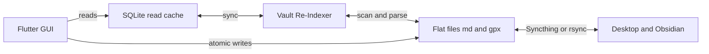

<div align="center">

# ObsidianFit

**An open-source, 100% offline-first mobile fitness app combining Strava-style GPS tracking and Hevy-style gym logging via a GUI-Over-Markdown architecture.**


</div>

---

## Why ObsidianFit?

Most fitness apps lock your history inside a proprietary cloud. ObsidianFit stores every workout and every GPS route as plain files you own, and puts a fast, modern dark-mode interface on top. You never see or type Markdown in the app, but you can open the same folder in [Obsidian](https://obsidian.md) on your desktop and query your training with Dataview, graph it, or back it up with Git.

## Key Pillars

| 📝 GUI-Over-Markdown | 🔄 Syncthing & rsync Native | ⚡ Dual-Layer Speed |
|---|---|---|
| A high-contrast dark-mode native GUI. Under the hood, flat `.md` notes (YAML frontmatter) and `.gpx` tracks are the single source of truth. **Zero lock-in.** | Sync across phone, tablet, and PC with no third-party cloud. Atomic writes avoid half-synced files, and Syncthing conflict copies (`*.sync-conflict-*.md`) and dotfiles are filtered out of indexing. | A Drift SQLite read-cache powers instant calendar and history views, kept honest by a background vault re-indexer that runs on launch and on app resume. |

## Features

### 🏋️ Gym Logger
- Workout sessions built from exercises and sets, with set types **Warmup (W)**, **Normal (N)**, **Drop (D)**, and **Failure (F)**
- Per-set weight, reps, and RPE
- Haptic rest timer
- Plate loading calculator
- Routine suggestions pulled from your active plan's weekly rotation
- Screen wake-lock while you train

### 🏃 Outdoor Activity Engine
- Lossless **GPX 1.1** recording and parsing, with pause/resume as separate track segments
- **MapLibre GL** route overlay (offline dark style by default)
- Bluetooth LE heart-rate monitors via the standard GATT Heart Rate Service (`0x180D`), with auto-reconnect
- Android foreground service and iOS location background mode, so recording survives a locked screen
- Activity notes link their route with an Obsidian wikilink: `gpx_file: "[[2026-10-22_1730_Route.gpx]]"`

### 📅 History & Calendar
- Monthly calendar with per-day markers for workouts and activities, a day preview sheet, and monthly totals
- Plan-aware "Today" card showing what your program schedules
- History list with session review sheets and route maps

## Architecture



```text
Flutter GUI --reads--> SQLite Read Cache <--> Vault Re-Indexer <--> Flat Files (.md / .gpx)
     |                                                                   ^   |
     +------------------------ atomic writes ---------------------------+   +--> Syncthing / rsync --> Desktop (Obsidian)
```

- **Flat files are the source of truth.** SQLite is a disposable cache that can be rebuilt at any time.
- Models support lossless round-trip parsing: Markdown → Dart model → Markdown.
- Domain hierarchy: `WorkoutSession → ExerciseEntry → SetEntry`, plus `ActivitySession` and `PlanProgram`.

### Vault layout

```text
/Documents/ObsidianFit/
├── Workouts/      # Flat .md workout notes with YAML frontmatter
├── Activities/    # Outdoor session .md logs with wikilink references
├── Tracks/        # Raw GPX 1.1 XML trace logs
└── Plans/         # Routines and program templates
```

Example workout note (`Workouts/2026-10-22_1800_Push_Day_A.md`):

```markdown
---
type: strength
split: "Push Day A"
date: 2026-10-22
duration_min: 52
total_volume_kg: 4850
---

## Barbell Bench Press
- Set 1: 80kg x 8 reps | RPE 7.0 | Type: N
- Set 3: 85kg x 6 reps | RPE 9.5 | Type: F
```

Reference schemas live in [`schemas/`](schemas/).

## Tech Stack

| Technology / Package | Purpose |
|---|---|
| **Flutter / Dart** | Cross-platform UI engine |
| **Drift** (`drift`, `drift_flutter`) | SQLite read cache |
| **`yaml`** + custom `FrontMatterCodec` | YAML frontmatter parsing and writing |
| **`xml`** | Lossless GPX 1.1 reading and writing |
| **`maplibre_gl`** | Hardware-accelerated offline/online map overlays |
| **`flutter_blue_plus`** | Bluetooth LE heart-rate monitor scanning and connection |
| **`geolocator`** + **`flutter_background_service`** | Background GPS tracking resilience |
| **`wakelock_plus`** | Keeps the display on during active logging |
| **`permission_handler`**, **`flutter_local_notifications`** | Runtime permissions and the ongoing "Recording" notification |

## Getting Started

### 1. Prerequisites
- [Flutter SDK](https://docs.flutter.dev/get-started/install) (Dart ^3.5)
- **Android:** Android Studio, Java 17, Android SDK
- **iOS:** Xcode and CocoaPods (macOS only)
- **Linux desktop:** the standard Flutter Linux toolchain (`clang`, `cmake`, `ninja-build`, `pkg-config`, GTK 3 dev headers)

### 2. Clone and set up

```bash
git clone https://github.com/<your-username>/obsidian_fit.git
cd obsidian_fit
flutter pub get
```

### 3. Run the tests

```bash
flutter analyze
flutter test
```

The suite is plain-Dart (GPX, Markdown round trip, re-indexer, plate math). The recording UI, BLE, background service, and wake lock need a real device.

### 4. Run the app

```bash
flutter run --release     # recommended on Android: debug builds can behave differently with background services
flutter run -d linux      # desktop
```

On Android, grant location, notifications, Bluetooth, and "All files access" when prompted so the vault can live in `Documents/ObsidianFit` where Syncthing can see it. See [`docs/phase3_platform_setup.md`](docs/phase3_platform_setup.md) for the full Android/iOS setup, permission rationale, Syncthing tips (add `*.tmp` to `.stignore`), and a device test checklist.

> Some vendors (Xiaomi, Huawei, Samsung, OnePlus) aggressively kill foreground services. Disable battery optimization for ObsidianFit; see [dontkillmyapp.com](https://dontkillmyapp.com).

## Roadmap

### Phases 1–4: Core Foundation
- [x] **Phase 1:** Flat Markdown storage, FrontMatter codec, Drift SQLite schema, background re-indexer
- [x] **Phase 2:** Dark theme shell, workout logger, haptic rest timer, plate math, calendar, history
- [x] **Phase 3:** GPX 1.1 recorder/parser, background GPS service, BLE heart-rate scanner, MapLibre overlay
- [x] **Phase 4:** Android permissions manifest, iOS scaffolding, screen wake lock, Syncthing conflict filter

### Phase 5: Multi-Discipline Gym Engine & Retro-Logging
- [ ] Backdated manual gym logger and manual outdoor activity logger (no GPS needed)
- [ ] Calendar: tap a past empty day to "+ Log Past Session"
- [ ] Calisthenics: bodyweight (`+0 kg`) vs weighted (`+X kg`) toggle
- [ ] Isometric holds tracked in seconds (planks, L-sits, handstands)
- [ ] Plyometrics: box height, contact time, jump counts
- [ ] Stretching and mobility with auto-advancing timers, plus prebuilt mobility plans in `/Plans/`

### Phase 6: Strava-Grade Outdoor Suite & Analytics
- [ ] 1 km / 1 mi auto-laps and post-activity split tables
- [ ] Interactive pace and elevation profiles beside the map
- [ ] Ghost route navigation from any existing `.gpx`
- [ ] Multi-sport dashboard, weekly stats, and all-time PR detection

## Contributing

Issues and pull requests are welcome. Please run `flutter analyze` and `flutter test` before submitting, and keep the core rule intact: **the user never sees raw Markdown, and the flat files stay the source of truth.**

## License

Released under the MIT License. See `LICENSE`.
