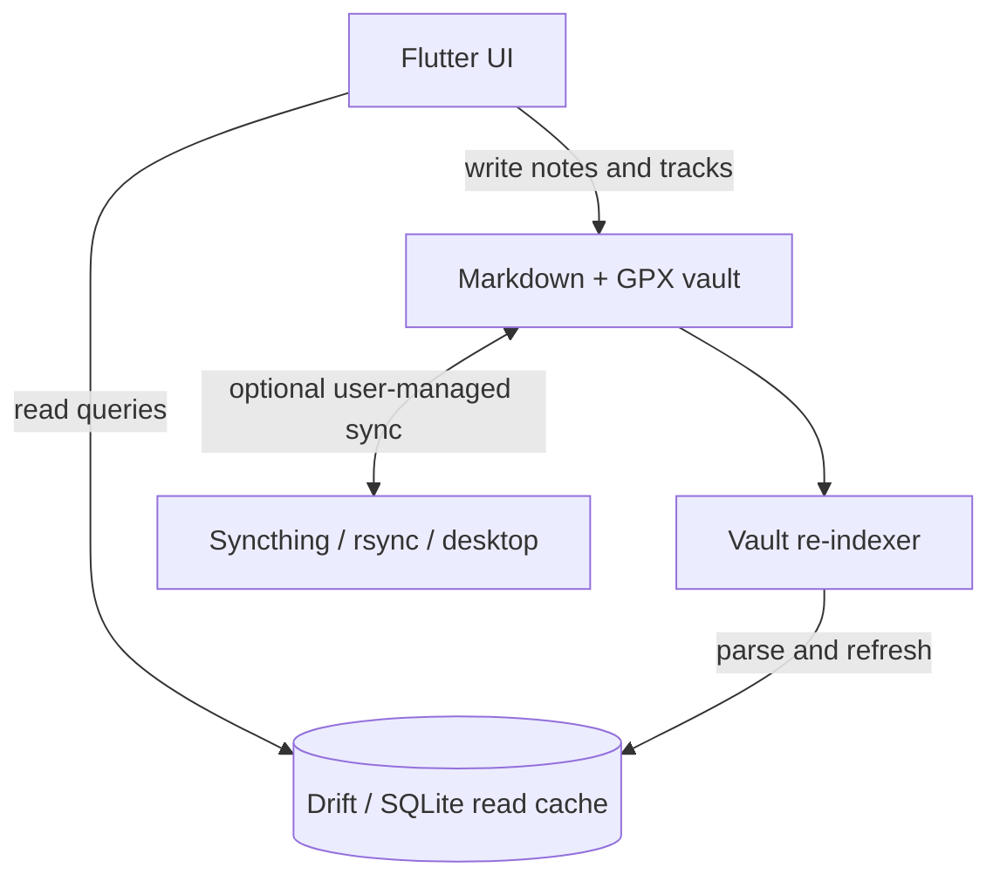

<div align="center">

# ObsidianFit

**An open-source, local-first fitness tracker with a GUI over user-owned Markdown and GPX files.**


</div>

ObsidianFit puts a fitness interface over files you own. Gym sessions and activities are stored as Markdown with YAML frontmatter; GPS routes are stored as GPX 1.1 XML. Drift/SQLite accelerates calendar, history, and dashboard queries but is a **rebuildable read cache**, not the source of truth.

> **Project status:** The original six-phase feature roadmap is implemented and the project is in V2 refinement. The existing UI is not automatically the final design. See [the implementation plan](docs/IMPLEMENTATION_PLAN.md), [engineering context](docs/CONTEXT.md), and [repository map](docs/REPO_MAP.md).

> **Verification provenance:** On 2026-10-26 the developer reported a local run with `flutter analyze` clean and all 382 tests passing after the flexible manual activity logging work. These were owner-reported results, not run by this documentation update. They do not establish automated CI coverage or complete real-device validation.

## Why ObsidianFit?

- **Your data stays yours.** Notes are plain files you can inspect, back up, sync, and query outside the app.
- **GUI over Markdown.** Record and review sessions in the app, then open the same vault in [Obsidian](https://obsidian.md).
- **Local-first syncing.** Sync the vault yourself with tools such as Syncthing or rsync; the app does not require a proprietary fitness-data cloud.
- **Recoverable index.** The vault re-indexer can rebuild the SQLite cache from Markdown notes.

## Features in the current baseline

### Gym logging
- Live workout sessions organized into exercises and sets.
- External-load and bodyweight/weighted-bodyweight sets.
- Reps and timed isometric holds.
- Optional RPE and plyometric box-height/contact-time fields.
- Rest timer, plate-loading calculator, and screen wake-lock during active logging.
- Retro/manual workout entry and routine-aware suggestions.
- Manual/historical set completion does not start the live rest timer.

### Activities
- GPS-recorded outdoor activities with GPX 1.1 tracks and segmented pause/resume recording.
- MapLibre route visualization, live splits, pace/elevation profiles, and ghost-route overlays.
- Optional Bluetooth LE heart-rate monitor using the standard Heart Rate Service (`0x180D`).
- Background tracking and a persistent recording notification where supported by the platform.
- Manual non-GPS activity logging for distance sports and activities such as Taekwondo, boxing, yoga, stretching, and walking. Duration is required; distance, elevation, heart rate, RPE, and notes are optional.
- Manual/past activity entry is separate from live tracking. A **live elapsed timer for non-GPS activity is planned next and is not present in the reviewed baseline**.

### Calendar, history, and analytics
- Monthly calendar with session markers, day previews, and monthly totals.
- History list and session review.
- Retroactive logging from past calendar dates.
- Personal records including estimated bench 1RM, longest plank, longest run, and fastest 5K.
- Weekly multi-sport statistics for lifting volume, activity distance, and mobility time.

## Architecture



The rule is simple: **files are the durable source of truth; SQLite is disposable**. Hidden directories are filtered during indexing. Re-indexing should restore the database from the vault.

### Vault layout

The default vault is named `ObsidianFit` in an application documents directory. On Android, the service prefers `/storage/emulated/0/Documents/ObsidianFit` when all-files access is granted, otherwise it may use an app-specific external or documents directory.

```text
ObsidianFit/
├── Workouts/   # Gym session Markdown
├── Activities/ # Activity Markdown, GPS or non-GPS
├── Tracks/     # GPX 1.1 route files
└── Plans/      # Workout/mobility program notes
```

### Example workout note

```markdown
---
type: strength
split: "Push Day A"
date: 2026-10-22
time_started: "18:00"
duration_min: 52
---

## Barbell Bench Press
- Set 1: 80kg x 8 reps | RPE 7.0 | Type: N
- Set 2: BW+10kg x 6 reps | RPE 8.5 | Type: N
- Set 3: BW+0kg | Hold: 60s | Type: N
```

See [schemas/](schemas/) for baseline note examples and extension contracts. The baseline schema examples are also test fixtures; extensions are documented in the Phase 5 sidecar schemas.

## Technology

| Technology | Role |
|---|---|
| Flutter / Dart | Cross-platform UI and application logic |
| Drift / SQLite | Rebuildable query cache |
| YAML + `FrontMatterCodec` | Markdown frontmatter parsing and encoding |
| `xml` | GPX parsing and serialization |
| `maplibre_gl` | Route visualization |
| `flutter_blue_plus` | BLE heart-rate monitor |
| `geolocator`, `flutter_background_service` | Location recording and background tracking |
| `wakelock_plus` | Keep display awake during active sessions |
| `permission_handler`, `flutter_local_notifications` | Platform permissions and recording notification |

## Getting started

### Prerequisites
- Flutter SDK and Dart compatible with the `^3.5.0` constraint in `pubspec.yaml`.
- **Android:** Android Studio, Android SDK, compatible Java toolchain.
- **iOS:** macOS, Xcode, CocoaPods.
- **Linux desktop:** Flutter Linux dependencies such as `clang`, `cmake`, `ninja-build`, `pkg-config`, and GTK development headers.

### Clone and fetch dependencies

```bash
git clone https://github.com/mxtwng/Claude-ObsidianFit.git
cd Claude-ObsidianFit
flutter pub get
```

### Analyze and test

Run these separately when diagnosing failures:

```bash
flutter analyze
flutter test
```

### Launch

```bash
# Linux desktop
flutter run -d linux

# Connected Android device
flutter run --release

# Android debug APK
flutter build apk --debug
```

GPS, background services, BLE, notifications, permissions, and wake-lock behavior depend on platform lifecycle and device policies. Verify them on real target hardware; desktop/widget tests do not prove device behavior. See [platform setup and device testing](docs/phase3_platform_setup.md).

## Development status

The original six phases cover storage/indexing, gym UI/calendar, GPS/BLE, platform configuration, multi-discipline/manual logging, and outdoor analytics. V2 refinement remains active. Current priorities include live non-GPS timed activity, clearer activity-first entry points, robust manual/live boundaries, and separating plans from actual sessions.

Before implementing a task, read [CLAUDE.md](CLAUDE.md), [the implementation plan](docs/IMPLEMENTATION_PLAN.md), [engineering context](docs/CONTEXT.md), and [the repository map](docs/REPO_MAP.md). Requirements in planning documents are not proof a feature is already implemented; confirm behavior in source and tests.

## Contributing

Prefer evidence-based, testable changes. Preserve Markdown/GPX round trips and historical data. Add regression tests for parsing, persistence, indexing, timing, and logger behavior. For Dart changes, format touched files, run focused tests, then run `flutter analyze` and `flutter test`. Clearly distinguish automated results from real-device verification.

## License

MIT. See [LICENSE](LICENSE).
