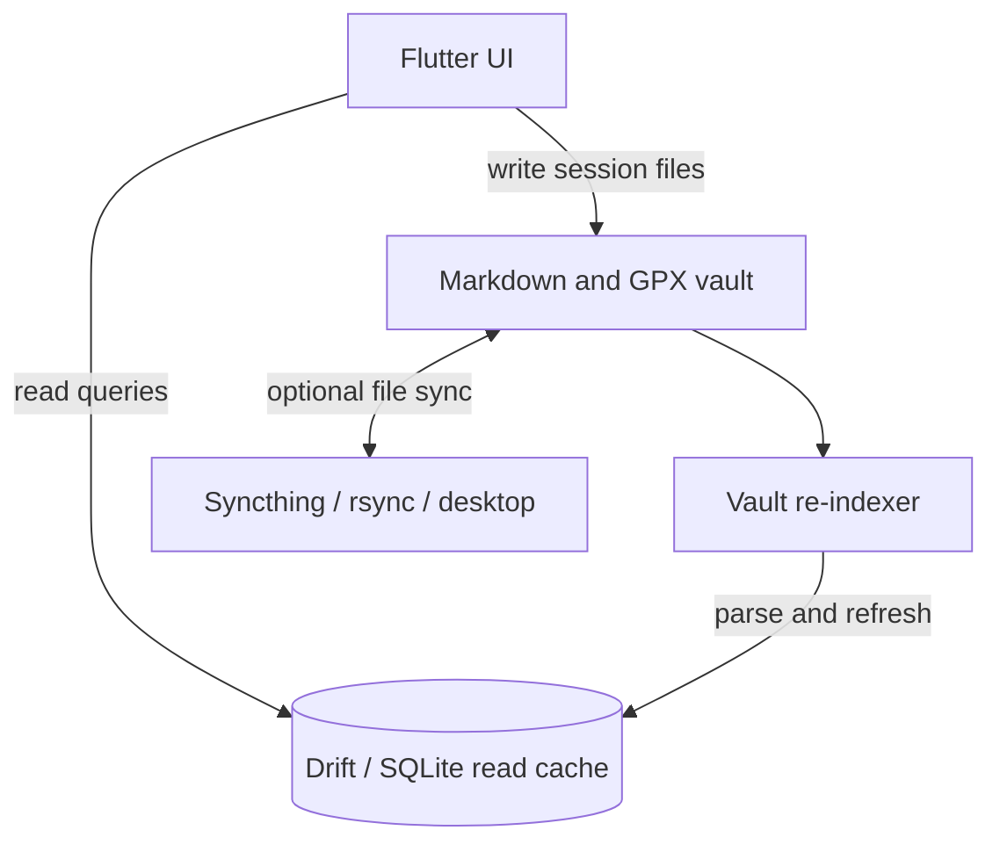

<div align="center">

# ObsidianFit

**An open-source, local-first fitness app combining GPS activity tracking and gym workout logging through a GUI-over-Markdown architecture.**


</div>

ObsidianFit puts a native, high-contrast fitness interface over files you own. Workout history is stored as Markdown with YAML frontmatter, and GPS tracks are stored as GPX 1.1 XML. The app uses a Drift SQLite database as a rebuildable read-cache rather than making a proprietary database the source of truth.

> **Project status:** The six-phase Demo 1 feature roadmap has been implemented, and the project is moving into V2 refinement. Existing behavior and UI are a starting point, not automatically the final design. See [`docs/IMPLEMENTATION_PLAN.md`](docs/IMPLEMENTATION_PLAN.md) for implementation priorities and [`docs/CONTEXT.md`](docs/CONTEXT.md) for engineering context.

> **Demo 1 verification (2026-10-24):** The developer's latest local run reports `flutter analyze` with no issues and `flutter test` with all 288 tests passing. These are local results, not a claim of automated CI coverage or full real-device validation.

## Why ObsidianFit?

- **Your data stays yours.** Workouts and activities are ordinary files that can be read, backed up, synced, and queried outside the app.
- **GUI over Markdown.** Record and review sessions through the app; open the same vault in [Obsidian](https://obsidian.md) when you want direct access to the notes.
- **Local-first syncing.** Use tools such as Syncthing or rsync to copy the vault between devices without depending on a proprietary fitness-data cloud.
- **Fast views, rebuildable cache.** Drift/SQLite supports calendar, history, and dashboard queries. The vault re-indexer can repopulate the cache from the flat files.

## Features

### Gym logging

- Workout sessions organized into exercises and sets.
- Legacy set markers exist in the current implementation; their role is being reviewed as part of V2.
- Record load, reps, and optional RPE where applicable.
- Weighted-bodyweight sets (`BW+Xkg`) with only the external added load counted toward tonnage.
- Timed isometric holds, including planks and static skills.
- Plyometric fields for box height and contact time.
- Haptic rest timer, plate-loading calculator, and screen wake-lock during active logging.
- Backdated workouts and routine-aware workout suggestions.

### Outdoor activities

- GPX 1.1 track recording, parsing, and writing.
- GPS track segments preserve pauses rather than drawing a false straight line between segments.
- MapLibre GL route visualization.
- Bluetooth LE heart-rate monitors using the standard Heart Rate Service (`0x180D`).
- Background tracking support and a persistent recording notification where supported by the platform.
- Manual outdoor activity logging without a GPX track.
- Live 1 km / 1 mi split calculation, split tables, and pace/elevation profiles.
- Ghost-route overlays from saved `.gpx` files in `Tracks/`.

### History and analytics

- Monthly calendar with workout/activity markers, day previews, and monthly totals.
- History list and session review sheets.
- Retroactive logging from past calendar dates.
- Personal-record tracking, including estimated 1RM bench, maximum plank duration, longest run, and fastest 5K.
- Weekly multi-sport statistics for workout volume, activity distance, and mobility time.

## Architecture



The key rule is that **flat files are the source of truth; SQLite is a disposable read-cache**. If the cache is lost or stale, it should be rebuildable by scanning and parsing the vault. The app filters hidden directories and Syncthing conflict copies so they do not become duplicate sessions.

### Vault layout

The app stores its vault in the device's `Documents/ObsidianFit/` directory where platform permissions allow it:

```text
/Documents/ObsidianFit/
├── Workouts/      # Gym sessions as Markdown files
├── Activities/    # GPS and manually logged activity notes
├── Tracks/        # GPX 1.1 route files
└── Plans/         # Workout routines and mobility templates
```

Example workout note:

```markdown
---
type: strength
split: "Push Day A"
date: 2026-10-22
time_started: "18:00"
duration_min: 52
---

## Barbell Bench Press
- Set 1: 80kg x 8 reps | RPE 7.0 | Type: N
- Set 2: BW+10kg x 6 reps | RPE 8.5 | Type: N
- Set 3: BW+0kg | Hold: 60s | Type: N
```

Refer to [`schemas/`](schemas/) for the project's note and set-format specifications.

## Technology stack

| Technology / package | Role |
|---|---|
| Flutter / Dart | Cross-platform UI and application logic |
| Drift (`drift`, `drift_flutter`) | SQLite read-cache and database access |
| `yaml` and `FrontMatterCodec` | Markdown YAML frontmatter parsing and writing |
| `xml` | GPX 1.1 parsing and serialization |
| `maplibre_gl` | Route map and polyline rendering |
| `flutter_blue_plus` | BLE heart-rate monitor scanning and connection |
| `geolocator`, `flutter_background_service` | Location tracking and background-service support |
| `wakelock_plus` | Prevents display timeout during active sessions |
| `permission_handler`, `flutter_local_notifications` | Runtime permissions and recording notification |

## Getting started

### Prerequisites

- Flutter SDK with a Dart SDK compatible with the `^3.5.0` constraint in `pubspec.yaml`.
- **Android:** Android Studio, Android SDK, and a compatible Java toolchain.
- **iOS:** macOS, Xcode, and CocoaPods.
- **Linux desktop:** Flutter Linux dependencies, including `clang`, `cmake`, `ninja-build`, `pkg-config`, and GTK development headers.

### Clone and fetch dependencies

```bash
git clone https://github.com/mxtwng/Claude-ObsidianFit.git
cd Claude-ObsidianFit
flutter pub get
```

### Analyze and test

Run these as separate commands when diagnosing a failure, so a non-zero analyzer exit does not prevent the test suite from running:

```bash
flutter analyze
flutter test
```

### Launch

```bash
# Linux desktop
flutter run -d linux

# Connected Android device (use a release build when validating background behavior)
flutter run --release

# Build an Android debug APK
flutter build apk --debug
```

GPS, background-service behavior, BLE, notifications, and wake-lock behavior depend on platform permissions and vendor power-management policies. Verify them on the real target device, not only in unit tests or a desktop build. On Android, grant the required location, Bluetooth, and notification permissions when prompted. Consult [`docs/phase3_platform_setup.md`](docs/phase3_platform_setup.md) for platform setup and device-testing guidance.

## Development status

All six planned feature phases are implemented:

- [x] **Phase 1 — Storage foundation:** Markdown/GPX persistence, domain models, Drift cache, vault re-indexer.
- [x] **Phase 2 — Gym UI and calendar:** dark UI, set logger, rest timer, plate calculator, calendar, history.
- [x] **Phase 3 — GPS and BLE:** GPX engine, location tracking, BLE heart rate, MapLibre route display.
- [x] **Phase 4 — Platform resilience:** platform configuration, permissions, wake-lock, conflict-file filtering.
- [x] **Phase 5 — Multi-discipline and retroactive logging:** weighted bodyweight, holds, plyometrics, mobility-oriented logging, manual activities, backdating.
- [x] **Phase 6 — Outdoor analytics:** splits, pace/elevation profiles, ghost routes, PR engine, weekly dashboard.

The feature roadmap being complete does not mean every platform behavior is production-validated or that the existing UI is final. V2 refinement prioritizes correctness and regression prevention while improving manual/live logging, activity-first workflows, and separation between plans and actual sessions. Follow [`docs/IMPLEMENTATION_PLAN.md`](docs/IMPLEMENTATION_PLAN.md) for requirements and [`docs/CONTEXT.md`](docs/CONTEXT.md) for the current engineering checkpoint.

## Contributing

Bug reports and focused improvements are welcome. Keep changes narrow, preserve Markdown/GPX round-trip behavior, and add regression tests for changes to parsing, persistence, indexing, or calculations. Before submitting a change, run `dart format` on the touched Dart files, then run `flutter analyze` and `flutter test`.

## License

Released under the MIT License. See [`LICENSE`](LICENSE).
